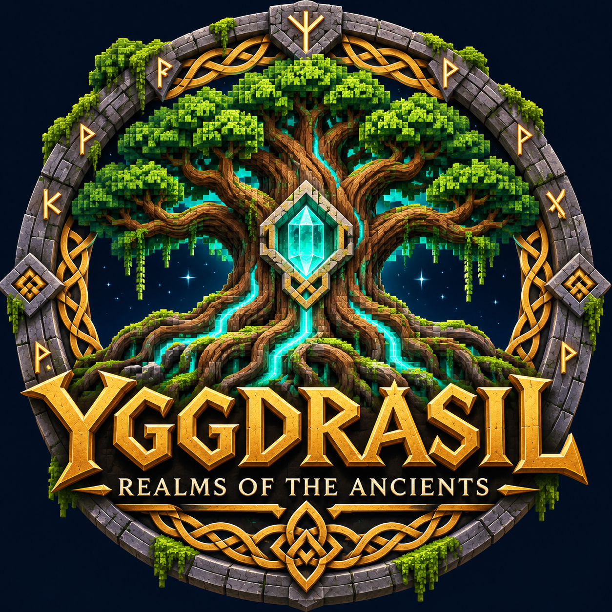
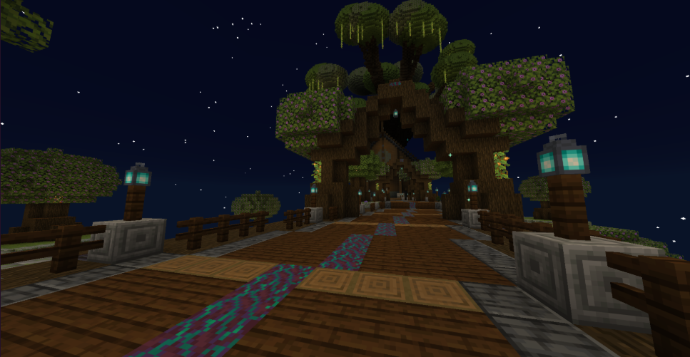
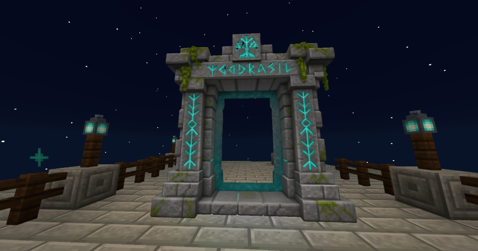
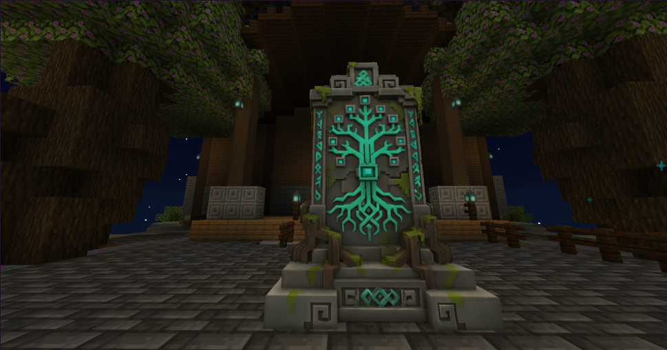
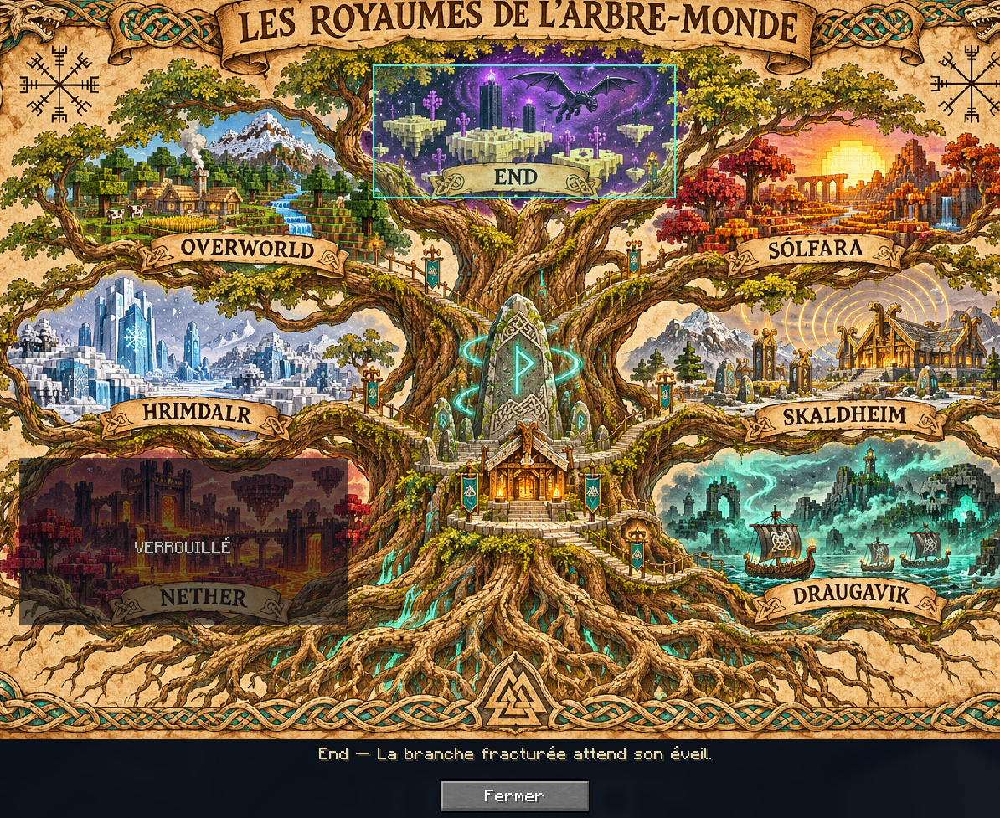

# SworldCraft — Yggdrasil 2.0.0-alpha.2

Première version jouable de la campagne demandée. **Minecraft 26.3 — NeoForge 26.3.0.102 — Java 25.** Le même JAR doit être installé côté client et serveur. Aucun autre mod obligatoire. Choisissez une difficulté non paisible pour les combats de gardiens.

Cette version ajoute une progression, de nouvelles données de génération et des entités : commencez sur un nouveau monde de test ou une copie de votre sauvegarde. Les minerais apparaissent dans les nouveaux chunks. Les sanctuaires sont ajoutés une fois à la première visite de chaque royaume. La carte illustrée est conservée.

## Parcours de l’aventure

| Étape | Royaume | Survie / exploration | Gardien et récompense |
|---|---|---|---|
| Départ | Overworld → Yggdrasil | Trouver une arche ancienne, la restaurer et l’éveiller avec un Cœur des Racines. | Accès à l’Arbre-Monde et à Hrimdalr. |
| 1 | Hrimdalr | Blizzards, brouillard, eau gelée, nourriture animale rare. Se réchauffer au feu ; équipement et runes réduisent le froid. | Hrymr, Jarl du Givre → âme de Sólfara. |
| 2 | Sólfara | Chaleur, eau et pluie acides, vapeurs et brume jaune légère. Distiller puis refroidir l’eau. | Eldsvorn, Gardien des Soufres → âme de Skaldheim. |
| 3 | Skaldheim | Brouillard chassé par les zones suffisamment éclairées. Apparitions spectrales dans la brume. Pas de malus thermique propre à ce royaume. | Skald le Parjure → âme de Draugavik. |
| 4 | Draugavik | Brume bleue repoussée par la Lanterne des Passeurs. Squelettes spectraux, spectres et effet de tornade au loin. | Nástrand, Passeur des Morts → âme du sanctuaire secret. |
| Fin | Sanctuaire de la Dernière Nuit | Portail dans le donjon de Draugavik ; grande arène circulaire sombre et runique. | Várnótt → une arme spéciale aléatoire et la relique finale. |

**Débloquer une branche :** tenez l’âme de mana obtenue en main principale et faites un clic droit sur la grande waystone d’Yggdrasil. La boule d’âme est consommée ; le déblocage est conservé pour ce joueur. L’ordre des royaumes est vérifié. Une âme déjà utilisée ou présentée trop tôt n’est pas consommée.

Les déblocages sont individuels. Un gardien peut être appelé à nouveau pour obtenir d’autres âmes. Les destinations vanilla sont conservées : Overworld accessible ; Nether après une première visite ; End selon la progression ou la commande administrateur existante.

## Départ : le portail restauré

Des ruines d’arches peuvent apparaître dans les nouveaux chunks de l’Overworld. Devant une arche inactive :

1. Utilisez **quatre pierres gravées**, une à une par clic droit.
2. Placez ensuite **un Cœur des Racines** par clic droit.
3. Les runes s’éveillent ; traversez l’ouverture pour rejoindre Yggdrasil.

Le Cœur des Racines se fabrique avec quatre éclats d’améthyste, quatre lingots de cuivre et une pousse d’arbre. Les pierres gravées utilisent pierre sculptée, améthyste et lapis-lazuli. Les recettes sont fournies dans le mod.

Le portail réellement utilisé est enregistré comme liaison personnelle pour cette dimension. En choisissant l’Overworld sur la waystone, le joueur retrouve ce portail : **pas de second portail créé à chaque retour**. Les portails déjà présents avant cette version ne sont pas effacés automatiquement.

## Survie

### Hrimdalr

La température corporelle s’affiche dans la barre d’action. Le froid s’aggrave dehors pendant les blizzards. En dessous des seuils, le joueur ralentit, gèle puis subit des dégâts. Un abri ralentit la perte de chaleur ; feu, feu de camp allumé, lave ou four en fonctionnement réchauffent à proximité. Trois pièces d’équipement du Givre ou la rune Chaleur des Foyers réduisent le froid. Les eaux exposées peuvent geler.

Préparez nourriture, charbon, bois et feux de camp avant de partir. La disparition des apparitions animales ordinaires rend la nourriture plus difficile à obtenir sur place.

### Sólfara

L’eau blesse et empoisonne. La pluie est dangereuse lorsque le joueur est exposé au ciel. La température augmente plus vite dehors que sous un toit. L’équipement solaire et le Sceau des Soufres apportent une protection partielle.

Pour obtenir de l’eau rafraîchissante :

1. Placez un **distillateur** au contact d’un four, fumoir ou haut-fourneau qui fonctionne.
2. Utilisez un seau d’eau sur le distillateur : vous récupérez un flacon chauffé et un seau vide.
3. Placez un **condenseur** au contact de glace, glace compactée, glace bleue ou d’eau.
4. Utilisez le flacon chauffé sur le condenseur pour obtenir de l’eau distillée refroidie.
5. Buvez le flacon par clic droit : il réduit la chaleur et retire le poison.

### Skaldheim et Draugavik

À Skaldheim, un niveau suffisant de lumière de bloc dégage la vue. La rune Lueur des Serments procure également une protection personnelle. Les spectres générés dans les brumes se dissipent lorsqu’ils entrent dans une zone protégée.

À Draugavik, les lumières ordinaires ne remplacent pas la **Lanterne des Passeurs**. Fabriquez-la avec l’Argent des Serments, de l’améthyste et une lanterne des âmes. Portez-la dans l’une des mains ou placez-la près de vous.

La tornade de Draugavik est décorative : elle n’arrache pas les blocs et ne crée pas de catastrophe. Son effet de particules se situe dans le ciel à l’est de la région du donjon ; sa visibilité dépend de la position, du réglage des particules et des shaders.

## Minerais, équipements et tables

| Royaume | Matériau | Enchantements dédiés |
|---|---|---|
| Hrimdalr | Acier du Givre — `hrimsteel` | Chaleur des Foyers ; Morsure du Givre. |
| Sólfara | Bronze solaire — `sunbronze` | Sceau des Soufres ; Tranchant des Braises. |
| Skaldheim | Argent des Serments — `oathsilver` | Lueur des Serments ; Briseur de Voile. |
| Draugavik | Acier des Âmes — `soulsteel` | Ancrage de l’Âme ; Moisson des Âmes. |

Chaque matériau possède minerai, matière brute, lingot, bloc, épée, pioche, hache, pelle, houe et quatre pièces d’armure. Les minerais bruts se fondent au four ou au haut-fourneau. Durabilité, efficacité et caractéristiques progressent d’un royaume au suivant, au-delà de l’équipement vanilla.

Les tables runiques se fabriquent avec une table d’enchantement, les lingots du royaume, de l’obsidienne et un bloc d’améthyste. Elles fonctionnent uniquement dans leur propre royaume :

- Objet à enchanter en **main principale**.
- **Trois lingots du royaume en seconde main**.
- **20 niveaux d’expérience** disponibles.
- Clic droit sur la table pour graver ou améliorer la rune adaptée à l’objet, jusqu’au rang III.

Ces enchantements ne figurent pas dans le tirage de la table d’enchantement vanilla. Les effets sont gérés par le mod : protection thermique, ralentissement ou embrasement à l’attaque, protection contre les spectres, dégâts contre les spectres et soin à leur mort.

## Gardiens, donjon et fin

Les sanctuaires de gardien se trouvent près de **x=160, z=0** dans chaque nouveau royaume ; la hauteur est adaptée au terrain et annoncée au premier voyage. Tuez un Veilleur du Givre, un Errant des Soufres ou un spectre du royaume : chaque élimination par un joueur donne une **pierre gravée**. Une pierre gravée entourée de quatre éclats d’améthyste fabrique une **offrande runique** (la pierre reste aussi fabricable avec la recette de restauration). Fabriquez une **offrande runique** et utilisez-la sur l’autel pour appeler le gardien. Un gardien vivant empêche d’en invoquer un second à proximité. Après sa mort, une nouvelle offrande permet de le réinvoquer. Chaque joueur non spectateur à moins de 200 blocs reçoit personnellement son âme ; il doit toujours la déposer lui-même sur la waystone.

Les gardiens ont une barre de boss, des attaques annoncées au sol, une seconde phase plus rapide et des renforts spectraux. Éloignez-vous des cercles d’avertissement avant l’impact.

Le donjon de Draugavik abrite le portail secret. Après avoir obtenu puis déposé son âme à Yggdrasil, revenez utiliser ce portail. Le sanctuaire final comporte une arène d’environ **172 blocs de diamètre**. Invoquez Várnótt avec une offrande au centre.

À sa défaite, les joueurs présents éligibles obtiennent une arme spéciale tirée au hasard — Lame des Valkyries, Lame des Abysses ou Marteau des Tempêtes — ainsi qu’une relique. Les armes ont une compétence de zone activée par clic droit, avec recharge. Les joueurs sont renvoyés au donjon d’origine ; une musique accompagne le retour jusqu’au passage vers Yggdrasil.

Déposez la **relique** sur la grande waystone pour lancer la conclusion : déplacement de caméra autour d’Yggdrasil, titres, crédits du studio et des musiques, choix d’avis « suite » ou « autre projet », puis retour dans l’Overworld avec restauration du mode de jeu. Le choix d’avis reste dans la sauvegarde ; aucun message n’est envoyé à un service externe.

## Construction facultative et monture

Un tableau des bâtisseurs se trouve sur le passage est, près de la waystone. Il indique les critères et la progression des trois pavillons facultatifs.

Parcelles : **x=76 à 92**, et **z=112 à 128**, **139 à 155**, **166 à 182**. Pour chaque pavillon, entre y=83 et y=96 : au moins douze bûches, soixante blocs de planches/pierre, trois lumières, un lit complet et une couverture au-dessus de la partie centrale. Décorez librement. Ces objectifs ne sont pas obligatoires pour finir l’aventure.

La récompense est le **Lien draconique**, qui permet de rappeler votre drake runique personnel. Le tableau peut rendre un lien perdu sans créer une seconde monture.

- Clic droit avec le lien : rappeler le drake.
- Clic droit sur son drake : monter.
- Accroupi + clic droit sur le drake : attendre / suivre.
- En selle : avancer/reculer, déplacement latéral et direction du regard ; Espace pour monter, regarder vers le bas en avançant pour descendre.
- Accroupi en selle : descendre de monture. Attention à la hauteur.

Le propriétaire et l’ordre d’attente sont sauvegardés. Le rappel réutilise la monture existante ; si son chunk vient d’être chargé, il peut être nécessaire de réutiliser le lien après quelques secondes.

## Essai rapide avec les commandes

Commandes administrateur uniquement :

| Commande | Usage |
|---|---|
| `/yggdrasil portal` | Crée directement un portail actif de test si l’espace est libre. |
| `/yggdrasil ruin` | Place une arche inactive devant vous pour essayer sa restauration. |
| `/yggdrasil enter` | Rejoint Yggdrasil. |
| `/yggdrasil testkit` | Donne équipements, lingots, âmes, offrandes et matériel de survie pour les essais. Les âmes doivent encore être déposées dans l’ordre. |
| `/yggdrasil shrine` | Dans un royaume de campagne, rejoint son sanctuaire de gardien. |
| `/yggdrasil drake` | Accorde le lien et rappelle un drake pour un essai direct. |
| `/yggdrasil ending_test` | Lance la conclusion pour un essai de la caméra, des crédits et du retour. |
| `/yggdrasil feedback` | Affiche le décompte des avis enregistrés dans ce monde. |
| `/yggdrasil unlock_end` | Débloque l’End vanilla pour ce monde. |
| `/yggdrasil renovate` | **Efface et reconstruit la zone du pont, de l’arbre et de la maison d’Yggdrasil.** Retirez vos objets avant utilisation. Inutile pour activer les nouvelles mécaniques. |

## Musiques et crédits à personnaliser

Les musiques personnelles n’ayant pas encore été fournies, cette alpha référence provisoirement des musiques déjà présentes dans Minecraft. Elle ne contient pas de fichiers audio personnels ajoutés.

Les trois événements sont `yggdrasil:campaign.boss`, `yggdrasil:campaign.return` et `yggdrasil:campaign.finale`. Pour les remplacer dans les sources ou un pack de ressources :

1. Ajoutez les fichiers `.ogg` dans `assets/yggdrasil/sounds/music/`.
2. Modifiez `assets/yggdrasil/sounds.json` pour référencer `yggdrasil:music/votre_fichier`, avec `stream: true`.
3. Renseignez les champs `title` et `creator` de `assets/yggdrasil/music_credits.json`. Les crédits lisent ces données.

Le nom du studio dans la conclusion est FourthRuneStudio.

## État de cette alpha

Les mécaniques sont implémentées et vérifiées côté serveur. Les cinq boss possèdent désormais leurs propres identifiants d’entité et variantes géométriques : couronne et épaules de glace, fournaise et cheminées, manteau et ramures, capuche et robe funéraire, ailes et couronne finale. Ils conservent une base humanoïde et les animations de déplacement du jeu ; ce ne sont pas encore cinq créatures animées sur mesure. Le drake possède son propre modèle cubique articulé. Le portail reste un modèle statique ; les effets emploient le rendu et les particules du jeu.

L’équilibrage d’une aventure complète, le rendu graphique dans un client, les shaders et la compatibilité avec tous les autres mods du modpack restent à éprouver en jeu. La cinématique et les sons provisoires pourront être ajustés avec vos musiques et vos retours.

## Sources et vérifications

Les sources contiennent déjà toutes les ressources nécessaires à la compilation. Avec Java 25 et Internet : `gradlew.bat build` sous Windows, ou `./gradlew build` sous Linux/macOS. Le JAR se trouve dans `build/libs`.

`modelTextureCheck` contrôle le clic gauche natif de 26.3, les références de textures OBJ et la géométrie du drake. `runServer -Pselftest` effectue les tests d’intégration et arrête le serveur. Utiliser uniquement un dossier et un monde de développement jetables, fraîchement créés. Une sortie Gradle réussie n’est pas suffisante : rechercher aussi `CAMPAIGN_SELFTEST_PASS` et `YGGDRASIL_SELFTEST_PASS`.

Modèles de la waystone et des portails, carte : éléments fournis par le créateur du projet. Nouveaux éléments : FourthRuneStudio. Les éléments basés sur les ressources et le rendu de Minecraft restent liés au jeu. Le squelette NeoForge conserve sa licence dans `TEMPLATE_LICENSE.txt`.

## Correctif alpha.2 — atmosphère et progression

- Correction du type de brouillard atmosphérique de Minecraft 26.3 et des limites terrain, ciel et nuages. Visibilité cible : Hrimdalr 10 blocs ; Sólfara 55 ; Skaldheim 16 / 38 sous protection ; Draugavik 18 / 38 sous protection.
- Blizzard permanent à Hrimdalr, neige renforcée dehors. Les toits bloquent les particules.
- Apparitions supplémentaires contrôlées dans les quatre royaumes, même autour des joueurs en créatif pour les essais. Pas d’apparition en Paisible ni autour d’un spectateur. Les créatures ne ciblent pas les joueurs créatifs.
- Les spectres évitent les zones protégées par la lumière / lanterne plutôt que d’être supprimés. Les apparitions recherchent un emplacement valide.
- Tornade décorative projetée dans le ciel depuis un point fixe x260, z65 : indépendante de la limite des particules et du brouillard du terrain. Sans dégâts. À valider visuellement avec le client et les shaders.
- Nouvelles textures 32px : minerais, ressources brutes, lingots, blocs métalliques, tables et icônes armes/outils/armures. Les textures portées sur le joueur restent celles de l’alpha précédente.
- ## The World Tree

## Ancient Portals

## The Great Waystone

## Explore the Realms

- Composant d’offrande garanti sur les créatures du royaume et âmes distribuées individuellement aux joueurs proches du boss.

Ce correctif fonctionne sur les chunks déjà explorés : aucune régénération nécessaire pour ces changements. Remplacer l’ancien JAR des deux côtés. Les identifiants des anciens gardiens sont conservés pour les sauvegardes existantes.
